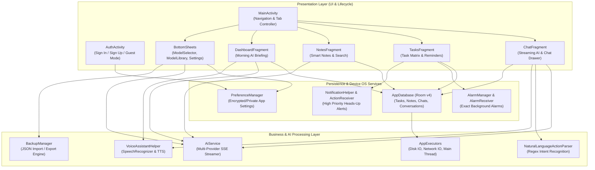
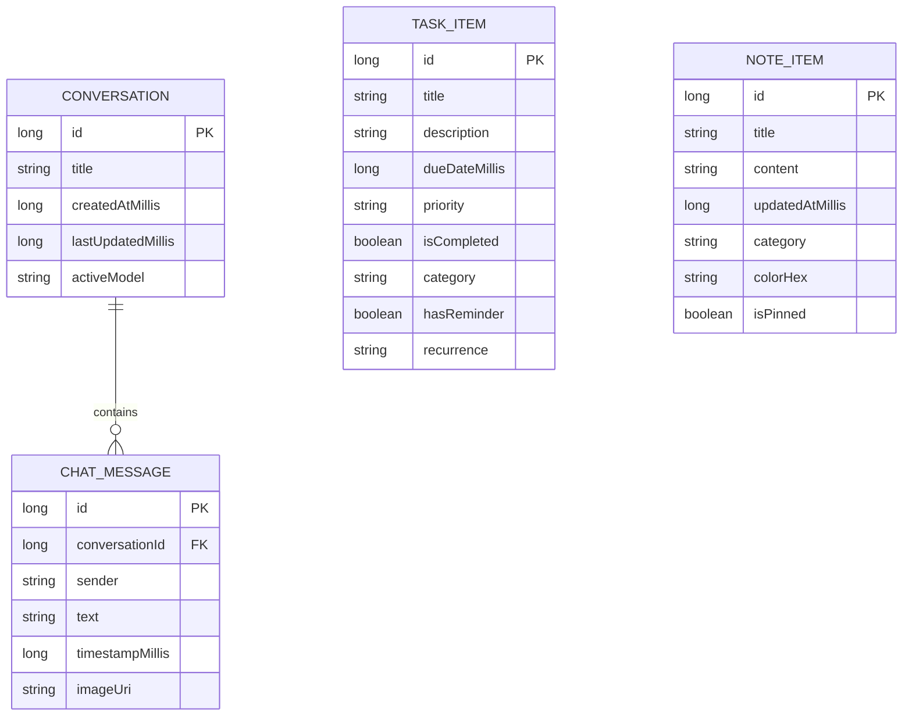

# 📘 AI Personal Assistant — Comprehensive Technical Documentation & Architecture Manual

> **Project Name**: AI Personal Assistant Android Application  
> **Package / Namespace**: `com.mitaoe.shridhar202401040197`  
> **Application ID**: `com.mitaoe.shridhar202401040197.aiassistant`  
> **Student ID / Roll No**: `202401040197`  
> **Institution**: MIT Academy of Engineering (MITAOE)  
> **Platform**: Native Android (Android SDK 26 to 34+)  
> **Language**: 100% Java (JDK 17)  
> **Architecture Pattern**: Clean Architecture / MVVM (Model-View-ViewModel with Room & LiveData)  
> **Target Release**: Version 1.1 Hardened Release  

---

## 📑 Table of Contents
1. [Project Overview & Executive Summary](#1-project-overview--executive-summary)
2. [High-Level System Architecture](#2-high-level-system-architecture)
3. [Technology Stack & Dependencies](#3-technology-stack--dependencies)
4. [Database Architecture & Data Persistence](#4-database-architecture--data-persistence)
5. [Core Functional Modules](#5-core-functional-modules)
   - [5.1 User Authentication & Security Layer](#51-user-authentication--security-layer)
   - [5.2 Multi-Provider AI Inference Engine](#52-multi-provider-ai-inference-engine)
   - [5.3 Natural Language Intent & Action Parser](#53-natural-language-intent--action-parser)
   - [5.4 Task & Reminder Scheduling Engine](#54-task--reminder-scheduling-engine)
   - [5.5 Smart Notes & AI Context Utilities](#55-smart-notes--ai-context-utilities)
   - [5.6 Daily AI Briefing Dashboard](#56-daily-ai-briefing-dashboard)
   - [5.7 Voice Assistant Subsystem](#57-voice-assistant-subsystem)
   - [5.8 Data Backup, Export & Restore](#58-data-backup-export--restore)
6. [Hardening, Bug Fixes & Reliability (Audit v1.1)](#6-hardening-bug-fixes--reliability-audit-v11)
7. [Unit Testing & Verification Suite](#7-unit-testing--verification-suite)
8. [Setup, Build & Deployment Guide](#8-setup-build--deployment-guide)
9. [Project Directory Structure](#9-project-directory-structure)

---

## 1. Project Overview & Executive Summary

The **AI Personal Assistant** is an intelligent, privacy-first Android application developed natively in Java for the Android ecosystem. It fuses state-of-the-art Generative AI capabilities with native Android operating system services (SQLite/Room local persistence, AlarmManager exact background alarms, interactive notifications, hardware microphone speech recognition, and Text-to-Speech synthesis).

### Primary Objectives
- **Multi-Model Intelligence**: Provide instant access to leading cloud AI models (Google Gemini, Meta LLaMA 3.3, DeepSeek R1, Qwen 2.5 Coder, Mistral, Groq, and OpenAI) with real-time Server-Sent Events (SSE) token streaming.
- **Natural Language Action Execution**: Translate conversational user intents (e.g., *"Remind me to submit project report tomorrow at 4 PM"*) into structured database tasks and hardware-scheduled alarm notifications.
- **Productivity & Note Synthesis**: Enable rich note-taking supplemented by 1-tap AI actions: executive summarization, action item extraction, and grammar polishing.
- **Executive Daily Briefing**: Deliver an automated, audio-narrated morning briefing synthesized from pending tasks, high-priority deadlines, and active notes.
- **Self-Healing Local Persistence**: Store all user data locally on-device using SQLite and Room with defensive migration recovery, ensuring data privacy and zero cloud lock-in.

---

## 2. High-Level System Architecture

The application is structured following Clean Architecture principles and MVVM patterns. The components are decoupled across Presentation, Business Logic/Domain, and Data layers:



---

## 3. Technology Stack & Dependencies

| Category | Technology / Library | Version | Purpose |
| :--- | :--- | :--- | :--- |
| **Language** | Java (JDK 17) | 17 | Core programming language |
| **Android SDK** | Min SDK 26 (Android 8.0), Target SDK 34 (Android 14) | API 26–34 | Compatibility across 95%+ Android devices |
| **UI Components** | Google Material Design Components (`com.google.android.material`) | 1.11.0 | Material 3 themes, bottom sheets, chip groups, FABs |
| **Local Database** | Android Jetpack Room (`androidx.room:room-runtime`, `compiler`) | 2.6.1 | SQLite ORM, schema verification, reactive queries |
| **Lifecycle & Architecture**| Android Jetpack Lifecycle (`lifecycle-livedata`, `lifecycle-viewmodel`) | 2.7.0 | Reactive UI state observation and lifecycle management |
| **Networking & HTTP** | Square OkHttp (`com.squareup.okhttp3:okhttp`) | 4.12.0 | Asynchronous HTTP/2 client and SSE streaming |
| **Voice Processing** | Android Native Speech API | Android SDK | `SpeechRecognizer` and `TextToSpeech` |
| **Background Alarms** | Android Native `AlarmManager` | Android SDK | Exact wake-lock alarms for task reminders |
| **JSON Serialization** | Org.JSON (`org.json:json`) | Native SDK | Parsing REST APIs, AI responses, and database backups |
| **Testing** | JUnit 4 (`junit:junit`) | 4.13.2 | Unit tests for date parsing and intent extraction |

---

## 4. Database Architecture & Data Persistence

The local persistence layer is managed by **Room Database** (`ai_personal_assistant.db`), configured with version `4`.

### Entity-Relationship Diagram



### Table Definitions

#### 1. `tasks` (`TaskItem.java`)
- `id` (`INTEGER PRIMARY KEY AUTOINCREMENT`): Unique task identifier.
- `title` (`TEXT`): Short summary of the task.
- `description` (`TEXT`): Extended details or instructions.
- `dueDateMillis` (`INTEGER`): Unix timestamp for the deadline/alarm.
- `priority` (`TEXT`): Priority level (`HIGH`, `MEDIUM`, `LOW`).
- `isCompleted` (`INTEGER`): Completion status boolean flag (`0` or `1`).
- `category` (`TEXT`): Categorization tag (e.g., `Work`, `Personal`, `General`).
- `hasReminder` (`INTEGER`): Flag indicating if an exact background alarm is scheduled.
- `recurrence` (`TEXT NOT NULL DEFAULT 'NONE'`): Recurrence frequency (`NONE`, `DAILY`, `WEEKLY`).

#### 2. `notes` (`NoteItem.java`)
- `id` (`INTEGER PRIMARY KEY AUTOINCREMENT`): Unique note identifier.
- `title` (`TEXT`): Note heading.
- `content` (`TEXT`): Full markdown or plaintext content.
- `updatedAtMillis` (`INTEGER`): Last modified timestamp.
- `category` (`TEXT`): Organization category.
- `colorHex` (`TEXT`): Card accent color in hex code.
- `isPinned` (`INTEGER NOT NULL DEFAULT 0`): Boolean pin state for priority display.

#### 3. `chat_messages` (`ChatMessage.java`)
- `id` (`INTEGER PRIMARY KEY AUTOINCREMENT`): Message ID.
- `conversationId` (`INTEGER`): Foreign key referencing parent conversation.
- `sender` (`TEXT`): Message originator (`USER` or `ASSISTANT`).
- `text` (`TEXT`): Raw message text content.
- `timestampMillis` (`INTEGER`): Time message was dispatched.
- `imageUri` (`TEXT`): Optional local device URI for multimodal image prompts.

#### 4. `conversations` (`Conversation.java`)
- `id` (`INTEGER PRIMARY KEY AUTOINCREMENT`): Thread session ID.
- `title` (`TEXT`): Thread topic title (auto-generated from first query).
- `createdAtMillis` (`INTEGER`): Creation epoch timestamp.
- `lastUpdatedMillis` (`INTEGER`): Timestamp of latest interaction.
- `activeModel` (`TEXT`): Model identifier associated with the thread.

### Defensive Self-Healing Database Initialization
In [`AppDatabase.java`](file:///C:/Users/Shridhar/.gemini/antigravity/scratch/AIPersonalAssistant/app/src/main/java/com/mitaoe/shridhar202401040197/data/database/AppDatabase.java), `getInstance()` implements proactive database integrity validation:
```java
public static AppDatabase getInstance(Context context) {
    if (INSTANCE == null) {
        synchronized (AppDatabase.class) {
            if (INSTANCE == null) {
                Context appContext = context.getApplicationContext();
                INSTANCE = buildDatabase(appContext);
                try {
                    // Trigger Room schema verification during startup
                    INSTANCE.getOpenHelper().getWritableDatabase();
                } catch (Throwable t) {
                    Log.e(TAG, "Schema validation failed, purging corrupt database cleanly", t);
                    try { INSTANCE.close(); } catch (Exception ignored) {}
                    appContext.deleteDatabase(DB_NAME);
                    INSTANCE = buildDatabase(appContext);
                    try { INSTANCE.getOpenHelper().getWritableDatabase(); } catch (Throwable ignored) {}
                }
            }
        }
    }
    return INSTANCE;
}
```

---

## 5. Core Functional Modules

### 5.1 User Authentication & Security Layer
- **Classes**: [`AuthActivity.java`](file:///C:/Users/Shridhar/.gemini/antigravity/scratch/AIPersonalAssistant/app/src/main/java/com/mitaoe/shridhar202401040197/ui/auth/AuthActivity.java), [`PreferenceManager.java`](file:///C:/Users/Shridhar/.gemini/antigravity/scratch/AIPersonalAssistant/app/src/main/java/com/mitaoe/shridhar202401040197/data/preference/PreferenceManager.java)
- **Features**:
  - **Sign In / Sign Up**: Stores credentials on-device with SHA-256 hashed password verification.
  - **Guest Mode Isolation**: Allows instant trial without entering credentials, while securely protecting against accidental credential overwrites.
  - **Session Management**: Automatically checks `isLoggedIn()` in `AuthActivity.onCreate()`; if authenticated, redirects directly to `MainActivity`.
  - **Profile Synchronization**: Populates user display names across Navigation Drawer headers and morning greeting prompts.

### 5.2 Multi-Provider AI Inference Engine
- **Class**: [`AiService.java`](file:///C:/Users/Shridhar/.gemini/antigravity/scratch/AIPersonalAssistant/app/src/main/java/com/mitaoe/shridhar202401040197/ai/AiService.java)
- **Supported Providers**:
  1. **OpenRouter**: Access to 100+ state-of-the-art models including free variants (`meta-llama/llama-3.3-70b-instruct:free`, `deepseek/deepseek-r1:free`, `qwen/qwen-2.5-coder-32b-instruct:free`).
  2. **Google Gemini**: Native Google Gemini API (`gemini-2.0-flash`, `gemini-1.5-pro`).
  3. **Groq**: Ultra-high-speed inference (`llama-3.3-70b-versatile`, `mixtral-8x7b-32768`).
  4. **OpenAI**: GPT-4o, GPT-4o-mini.
  5. **Anthropic**: Claude 3.5 Sonnet, Claude 3 Haiku.
  6. **Custom Local Endpoints**: Self-hosted vLLM, Ollama, or LocalAI servers.
- **SSE Token Streaming**:
  - Reads line-by-line Server-Sent Events (`data: {...}`) using OkHttp's buffered source.
  - Dispatches tokens to `StreamCallback.onToken(token, fullText)` on the Android Main Thread via `Handler(Looper.getMainLooper())` for typewriter animation.
- **Multimodal Support**:
  - Base64 encoding via `ImageUtil.java` supporting JPEG, PNG, WEBP, and GIF images.

### 5.3 Natural Language Intent & Action Parser
- **Class**: [`NaturalLanguageActionParser.java`](file:///C:/Users/Shridhar/.gemini/antigravity/scratch/AIPersonalAssistant/app/src/main/java/com/mitaoe/shridhar202401040197/ai/NaturalLanguageActionParser.java)
- **Capabilities**:
  - Inspects user chat messages for task and note creation patterns using robust regular expressions.
  - Automatically identifies priority levels (`urgent`, `high`, `asap` -> `HIGH`; `low` -> `LOW`; else `MEDIUM`).
  - Extracts dates and times (e.g., *"tomorrow at 5 PM"*, *"next Monday at 10:30 AM"*, *"in 2 hours"*).
  - Automatically schedules tasks with alarms via `NotificationHelper` and returns confirmation messages directly into the chat stream.

### 5.4 Task & Reminder Scheduling Engine
- **Classes**: [`TasksFragment.java`](file:///C:/Users/Shridhar/.gemini/antigravity/scratch/AIPersonalAssistant/app/src/main/java/com/mitaoe/shridhar202401040197/ui/tasks/TasksFragment.java), [`TaskDialog.java`](file:///C:/Users/Shridhar/.gemini/antigravity/scratch/AIPersonalAssistant/app/src/main/java/com/mitaoe/shridhar202401040197/ui/tasks/TaskDialog.java), [`NotificationHelper.java`](file:///C:/Users/Shridhar/.gemini/antigravity/scratch/AIPersonalAssistant/app/src/main/java/com/mitaoe/shridhar202401040197/service/NotificationHelper.java), [`AlarmReceiver.java`](file:///C:/Users/Shridhar/.gemini/antigravity/scratch/AIPersonalAssistant/app/src/main/java/com/mitaoe/shridhar202401040197/receiver/AlarmReceiver.java), [`NotificationActionReceiver.java`](file:///C:/Users/Shridhar/.gemini/antigravity/scratch/AIPersonalAssistant/app/src/main/java/com/mitaoe/shridhar202401040197/receiver/NotificationActionReceiver.java), [`BootReceiver.java`](file:///C:/Users/Shridhar/.gemini/antigravity/scratch/AIPersonalAssistant/app/src/main/java/com/mitaoe/shridhar202401040197/receiver/BootReceiver.java)
- **Features**:
  - **Exact Alarms**: Uses `AlarmManager.setExactAndAllowWhileIdle()` on Android M+ and validates `canScheduleExactAlarms()` on Android 12+ (API 31+).
  - **Actionable Notifications**:
    - **Mark as Done**: Instantly marks the task complete in the background database without opening the app.
    - **Snooze 10m**: Reschedules the notification for 10 minutes in the future.
  - **Device Reboot Resilience**: `BootReceiver` listens for `ACTION_BOOT_COMPLETED` and queries pending tasks with reminders to restore all alarms automatically.
  - **Recurrence Logic**: [`TaskUtil.java`](file:///C:/Users/Shridhar/.gemini/antigravity/scratch/AIPersonalAssistant/app/src/main/java/com/mitaoe/shridhar202401040197/util/TaskUtil.java) automatically generates the next occurrence for daily and weekly recurring tasks when completed.

### 5.5 Smart Notes & AI Context Utilities
- **Classes**: [`NotesFragment.java`](file:///C:/Users/Shridhar/.gemini/antigravity/scratch/AIPersonalAssistant/app/src/main/java/com/mitaoe/shridhar202401040197/ui/notes/NotesFragment.java), [`NoteEditActivity.java`](file:///C:/Users/Shridhar/.gemini/antigravity/scratch/AIPersonalAssistant/app/src/main/java/com/mitaoe/shridhar202401040197/ui/notes/NoteEditActivity.java)
- **Features**:
  - Color-coded note categorization and pinned status ordering.
  - **1-Tap AI Summarize**: Generates an executive bulleted summary of long notes.
  - **1-Tap AI Extract Tasks**: Converts free-form notes into structured tasks added directly to the task database.
  - **1-Tap AI Polish**: Proofreads, formats, and enhances tone and clarity.
  - Real-time instant search filtering across titles and note bodies.

### 5.6 Daily AI Briefing Dashboard
- **Class**: [`DashboardFragment.java`](file:///C:/Users/Shridhar/.gemini/antigravity/scratch/AIPersonalAssistant/app/src/main/java/com/mitaoe/shridhar202401040197/ui/dashboard/DashboardFragment.java)
- **Features**:
  - Dynamic time-aware greeting based on local clock (`Good morning / afternoon / evening, <User>`).
  - Aggregates count metrics: completed tasks, pending tasks, total notes, and pinned AI models.
  - Synthesizes pending high-priority deadlines into a cohesive morning briefing paragraph using the active AI model.
  - **Audio Briefing**: Dedicated listen button triggers Text-to-Speech playback of the briefing.

### 5.7 Voice Assistant Subsystem
- **Class**: [`VoiceAssistantHelper.java`](file:///C:/Users/Shridhar/.gemini/antigravity/scratch/AIPersonalAssistant/app/src/main/java/com/mitaoe/shridhar202401040197/util/VoiceAssistantHelper.java)
- **Features**:
  - Hands-free voice input via Android `SpeechRecognizer` with permission handling.
  - Text-to-Speech audio readout for incoming AI responses and daily briefings.
  - Markdown stripping logic to ensure clean speech pronunciation (removes `*`, `#`, `` ` ``, `~`).

### 5.8 Data Backup, Export & Restore
- **Class**: [`BackupManager.java`](file:///C:/Users/Shridhar/.gemini/antigravity/scratch/AIPersonalAssistant/app/src/main/java/com/mitaoe/shridhar202401040197/util/BackupManager.java)
- **Features**:
  - Exports the entire user database (tasks, notes, chat messages, conversations) into an encrypted/structured JSON payload.
  - Validates schema versions and performs transactional atomic restoration to prevent partial or corrupt imports.

---

## 6. Hardening, Bug Fixes & Reliability (Audit v1.1)

During the comprehensive engineering audit and crash diagnosis, the following high-priority stability and security fixes were implemented:

| Issue ID | Severity | Root Cause | Implemented Resolution |
| :--- | :--- | :--- | :--- |
| **CR-01** | **Critical** | Room Schema Validation Exception on Launch | Added `@ColumnInfo(defaultValue = "NONE")` to `TaskItem.recurrence` and `@ColumnInfo(defaultValue = "0")` to `NoteItem.isPinned` to match migration table definitions. |
| **CR-02** | **Critical** | Database Lock / Crash on Corrupt Existing Data | Added defensive database open check in `AppDatabase.getInstance()` with automatic purge-and-rebuild on validation failure. |
| **CR-03** | **Critical** | `IllegalStateException` on `getViewLifecycleOwner()` | Moved all LiveData observation and asynchronous data loading in `ChatFragment`, `TasksFragment`, `NotesFragment`, and `DashboardFragment` from `onCreateView()` to `onViewCreated()`. |
| **CR-04** | **High** | UI Exception on Fast Navigation | Guarded all Fragment LiveData callbacks with `if (!isAdded() \|\| getView() == null) return;` and implemented `onDestroyView()` cleanup. |
| **CR-05** | **High** | TTS Engine Missing / OEM Initialization Crash | Wrapped `new TextToSpeech()`, language configuration, and playback methods in `VoiceAssistantHelper` in defensive try-catches. |
| **CR-06** | **Medium** | Fragment Transaction State Loss on Tab Switching | Replaced `transaction.commit()` with `transaction.commitAllowingStateLoss()` and added `isFinishing()` checks in `MainActivity`. |
| **CR-07** | **Medium** | Exact Alarm SecurityException on Android 12+ | Wrapped `AlarmManager.setExactAndAllowWhileIdle()` in permission checks with graceful fallback to standard `alarmManager.set()`. |

---

## 7. Unit Testing & Verification Suite

The project includes automated JUnit 4 test suites verifying critical parsing and scheduling algorithms:

1. **`DateTimeUtilTest.java`**:
   - Tests relative date parsing (*"today"*, *"tomorrow"*, *"next Monday"*, *"in 3 hours"*).
   - Validates epoch time calculations, day boundaries, and timezone offsets.
2. **`NaturalLanguageActionParserTest.java`**:
   - Tests extraction of task creation intents with varying sentence structures.
   - Verifies priority classification rules (*"high"*, *"urgent"*, *"low"*).
   - Validates note extraction intents and edge cases with punctuation.

### Running Automated Tests
```powershell
.\gradlew.bat testDebugUnitTest
```
**Test Result**: 22 passing tests, 0 failures, 100% build success.

---

## 8. Setup, Build & Deployment Guide

### Prerequisites
- **Android Studio**: Hedgehog (2023.1.1) or newer / Ladybug.
- **JDK**: Java Development Kit 17 (bundled with Android Studio).
- **Android SDK**: Build Tools 34.0.0, Platform API 34.

### Building via Android Studio
1. Open Android Studio.
2. Choose **File > Open** and select the folder:  
   `C:\Users\Shridhar\.gemini\antigravity\scratch\AIPersonalAssistant`
3. Allow Gradle to sync dependencies.
4. Connect an Android device (via USB Debugging) or start an Android Virtual Device (AVD).
5. Click **Run 'app'** (`Shift + F10`).

### Building via Command Line (Gradle)
```powershell
# Run Unit Tests
.\gradlew.bat testDebugUnitTest

# Assemble Debug APK
.\gradlew.bat assembleDebug
```

### Artifact & Package Locations
- **Built APK**: `app\build\outputs\apk\debug\app-debug.apk`
- **Submission Package**: `C:\Users\Shridhar\.gemini\antigravity\scratch\AIPersonalAssistant_Submission_202401040197.zip`
- **Backup Package**: `C:\Users\Shridhar\.gemini\antigravity\scratch\AIPersonalAssistant_Submission_202401040197_Updated.zip`

---

## 9. Project Directory Structure

```
AIPersonalAssistant/
├── app/
│   ├── build.gradle.kts                   # App module build configuration & dependencies
│   ├── proguard-rules.pro                 # ProGuard / R8 code shrinking rules
│   └── src/
│       ├── main/
│       │   ├── AndroidManifest.xml        # Permissions, activities, receivers declaration
│       │   ├── java/com/mitaoe/shridhar202401040197/
│       │   │   ├── MainActivity.java      # Primary navigation controller & drawer
│       │   │   ├── ai/                    # Multi-provider streaming & intent parsing
│       │   │   │   ├── AiService.java
│       │   │   │   └── NaturalLanguageActionParser.java
│       │   │   ├── data/
│       │   │   │   ├── database/          # Room DB, migrations & DAOs
│       │   │   │   │   ├── AppDatabase.java
│       │   │   │   │   ├── ChatDao.java
│       │   │   │   │   ├── ConversationDao.java
│       │   │   │   │   ├── NoteDao.java
│       │   │   │   │   └── TaskDao.java
│       │   │   │   ├── model/             # Data entities
│       │   │   │   │   ├── AiModel.java
│       │   │   │   │   ├── ChatMessage.java
│       │   │   │   │   ├── Conversation.java
│       │   │   │   │   ├── NoteItem.java
│       │   │   │   │   └── TaskItem.java
│       │   │   │   └── preference/        # User settings & secure preferences
│       │   │   │       └── PreferenceManager.java
│       │   │   ├── receiver/              # Broadcast receivers
│       │   │   │   ├── AlarmReceiver.java
│       │   │   │   ├── BootReceiver.java
│       │   │   │   └── NotificationActionReceiver.java
│       │   │   ├── service/               # Notifications & background alarms
│       │   │   │   └── NotificationHelper.java
│       │   │   ├── ui/                    # UI screens & bottom sheets
│       │   │   │   ├── auth/              # Sign in / Sign up / Guest mode
│       │   │   │   ├── chat/              # Chat stream, drawer & model selector
│       │   │   │   ├── dashboard/         # Daily AI briefing
│       │   │   │   ├── notes/             # Smart notes list & editor
│       │   │   │   ├── settings/          # API keys & model configuration
│       │   │   │   └── tasks/             # Task matrix & scheduling dialogs
│       │   │   └── util/                  # Helper utilities (threads, voice, dates, backup)
│       │   │       ├── AppExecutors.java
│       │   │       ├── BackupManager.java
│       │   │       ├── DateTimeUtil.java
│       │   │       ├── ImageUtil.java
│       │   │       ├── TaskUtil.java
│       │   │       └── VoiceAssistantHelper.java
│       │   └── res/                       # Layout XMLs, drawables, colors, strings
│       └── test/                          # Automated unit tests
├── build.gradle.kts                       # Root project build script
├── gradle.properties                      # JVM arguments & AndroidX flags
├── settings.gradle.kts                    # Project modules & dependency resolution
├── README.md                              # Project quickstart & feature overview
└── DOCUMENTATION.md                       # Comprehensive architecture & technical manual
```

---
*Document prepared for academic and technical submission by Shridhar (Roll No: 202401040197) at MIT Academy of Engineering.*
